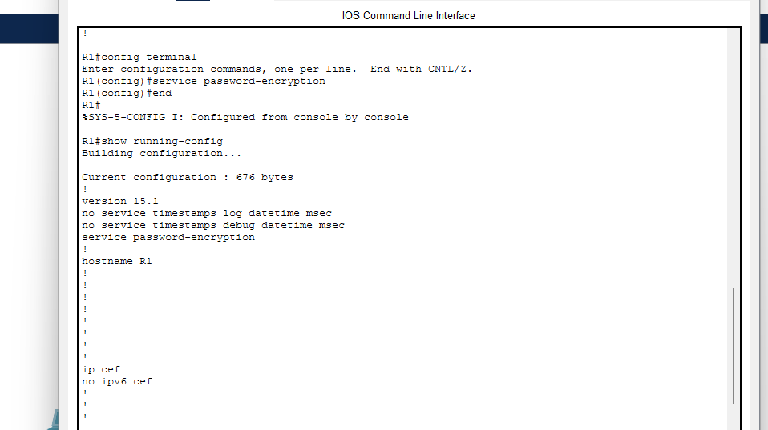
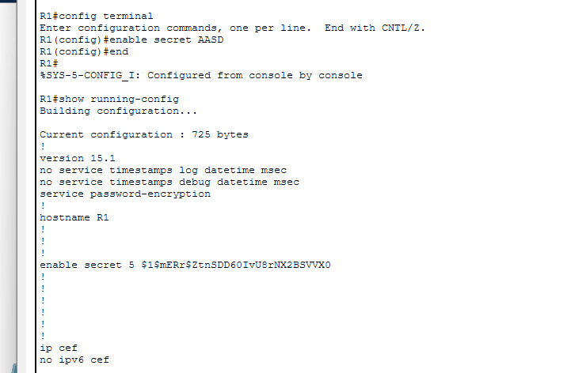
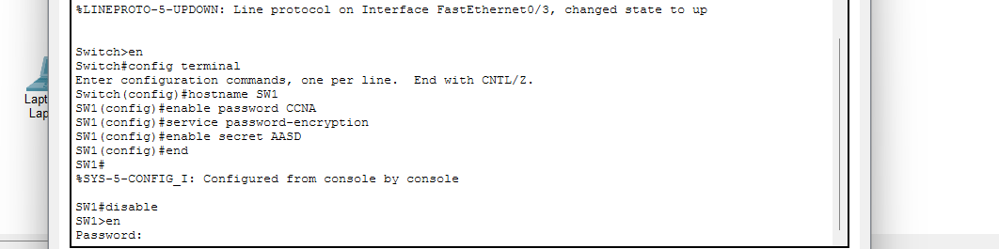

🌐 # Lab: Basic Device Security (Cisco Packet Tracer)

📁## Overview

A short lab on securing access to Privileged EXEC mode on a Cisco router and switch using hostnames, password encryption, and enable secrets.

---

## Topology

| Device | Model |
|--------|-------|
| Router1 (R1) | Cisco 2911 Router |
| Switch1 (SW1) | Cisco 2960-24TT Switch |
| Laptop1, Laptop2 | Laptop-PT |


---
⚙️Configuration Details
## Step 1: Enable Password Encryption on R1



```
R1(config)# service password-encryption
R1(config)# end
R1# show running-config
```

`service password-encryption` appears in the running configuration, so passwords stored on the router are no longer shown in plain text.

---

## Step 2: Configure Enable Secret on R1



```
R1# config terminal
R1(config)# enable secret AASD
R1(config)# end
R1# show running-config
```

The running configuration shows the secret stored as a hash (`enable secret 5 ...`) instead of the clear-text password.

---

## Step 3: Test Privileged Access on R1


```
R1# disable
R1> enable
Password:
```

After returning to user mode, the router asks for a password before allowing access to Privileged EXEC mode again.

---

## Step 4: Configure Security on the Switch (SW1)



```
Switch> en
Switch# config terminal
Switch(config)# hostname SW1
SW1(config)# enable password CCNA
SW1(config)# service password-encryption
SW1(config)# enable secret AASD
SW1(config)# end
```

Then the access was tested:

```
SW1# disable
SW1> en
Password:
```

The switch also asks for a password before entering Privileged EXEC mode.

---

