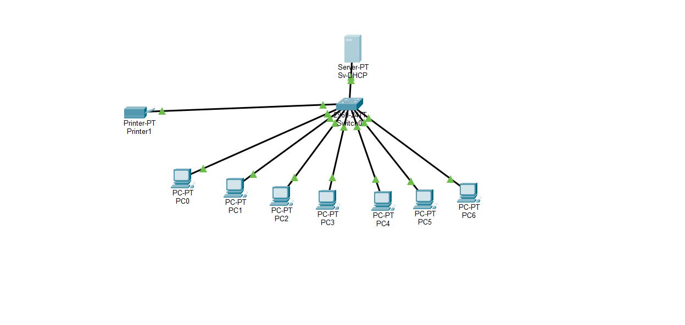
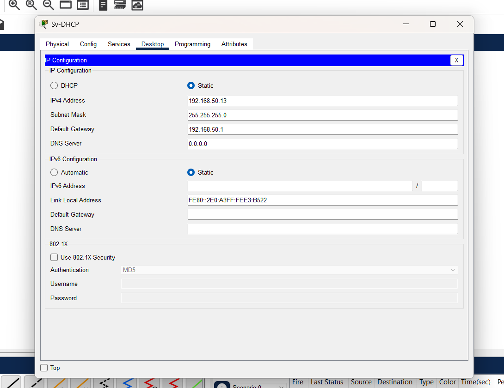
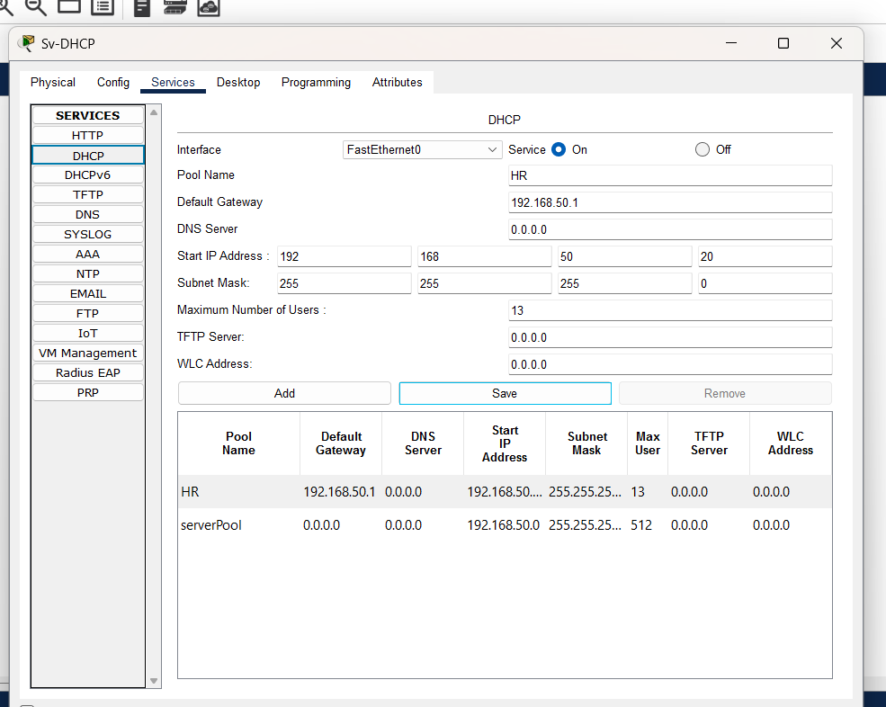
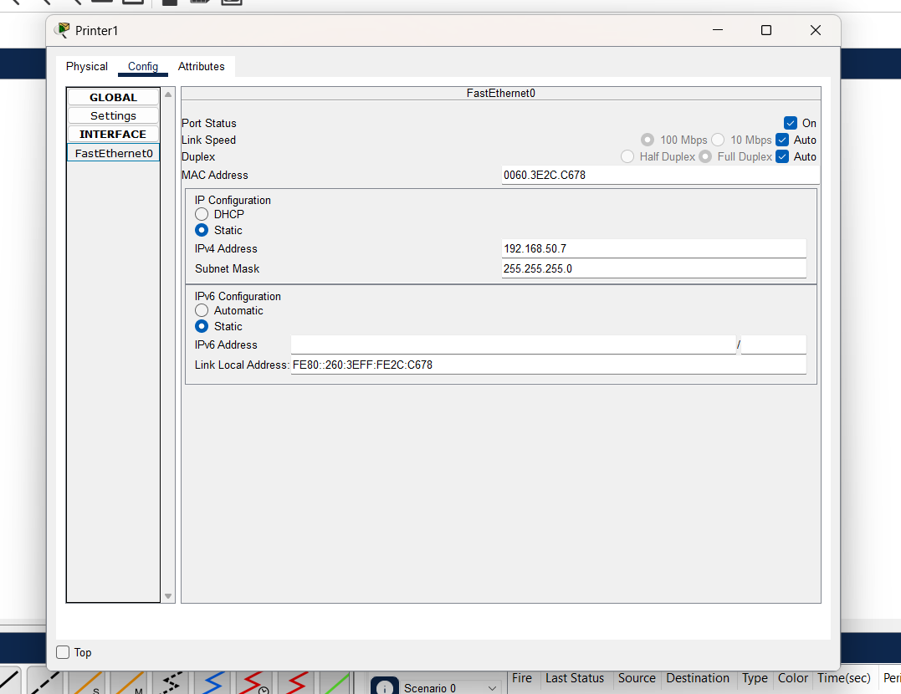
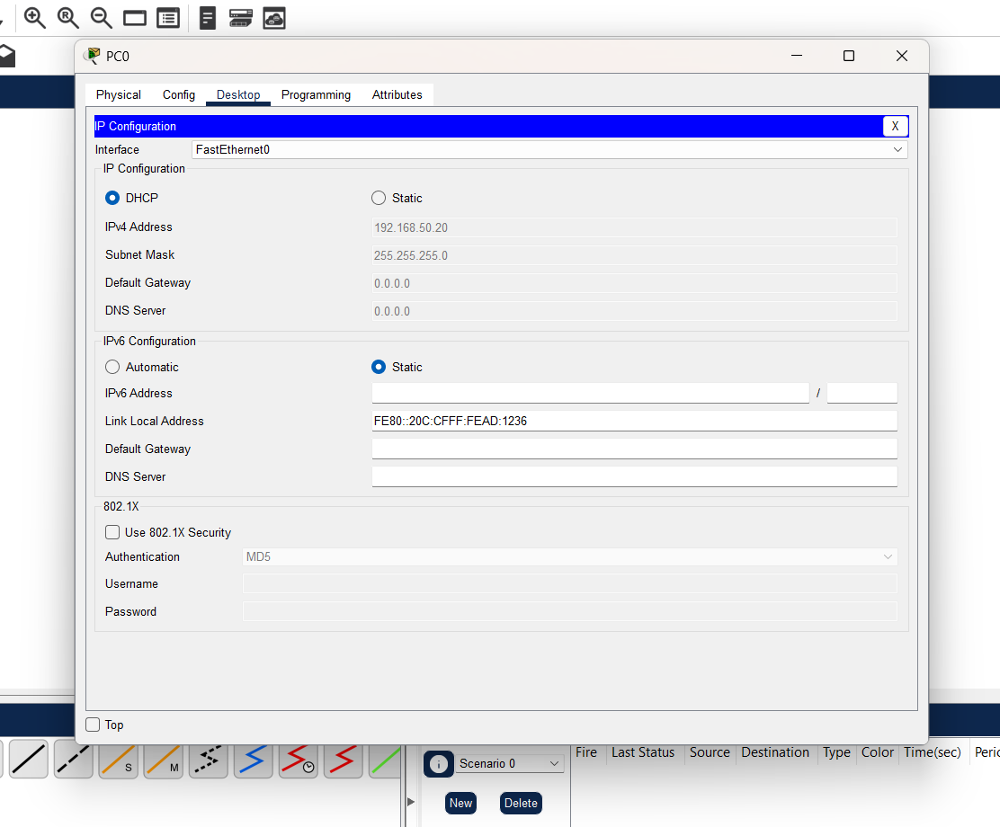
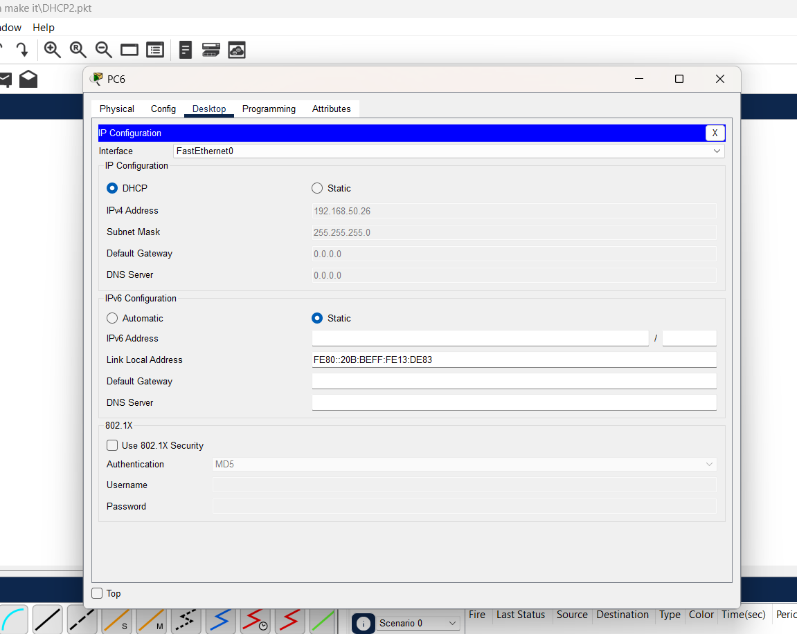
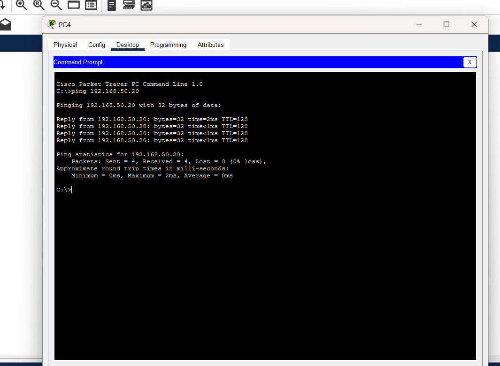
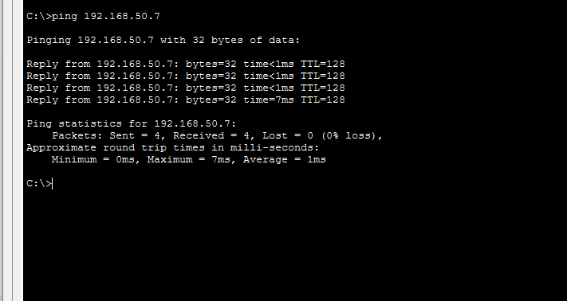

# 🌐 Cisco Packet Tracer - DHCP & Static IP Lab

A practical networking lab demonstrating dynamic IP allocation via DHCP alongside static IP configuration for network peripherals (Printer) to prevent IP conflicts.

---

## 📁 Repository Structure

* **`assets/`** - Contains network topology diagrams, configuration screenshots, and ping verification tests.
* **`labs/`** - Contains the executable Packet Tracer file (`DHCP2.pkt`).

---

##  Network Topology

* **Sv-DHCP:** Central DHCP Server
* **Switch0:** Cisco 2960 Switch connecting all network devices
* **Clients:** 7 PCs (`PC0` to `PC6`) set to dynamic IP allocation (DHCP)
* **Printer1:** Assigned a Static IP (`192.168.50.7`)

---

## ⚙️ Configuration Details

### 1. DHCP Server Settings (`Sv-DHCP`)
- **Pool Name:** `HR`
- **Default Gateway:** `192.168.50.1`
- **Start IP Address:** `192.168.50.20` (Excluding `.1` to `.19` for static assignments)

---

### 2. Switch Port Status & VLAN Setup
- Verified active FastEthernet interfaces connecting the server, PCs, and Printer.

---

### 3. Static IP Setup (Printer)
- **IPv4 Address:** `192.168.50.7`
- **Subnet Mask:** `255.255.255.0`

---

### 4. Client IP Lease Verification

- **PC0 Lease:** Successfully obtained IP `192.168.50.20` via DHCP.

- **PC6 Lease:** Successfully obtained IP `192.168.50.26` via DHCP.

---

## ✅ Connectivity Verification (Ping Tests)

1. **Ping Test to PC4:** End-to-end connectivity verified with **0% packet loss**.

2. **Ping Test to Static Printer (`192.168.50.7`):** Communication verified with **0% packet loss**.

