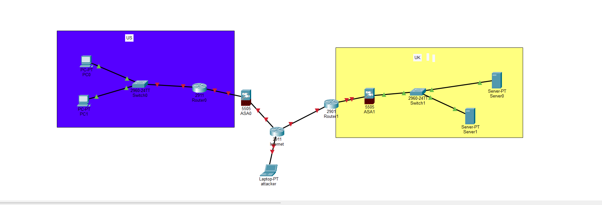

# Network Device

## About
A simple Packet Tracer topology connecting two separate networks—**US** (workstations) and **UK** (servers)—across a middle network:
- **US:** `PC0`, `PC1` → `Switch0` → `Router0` → `ASA0`
- **Middle / External:** `Internet` router with an `attacker` laptop
- **UK:** `Router1` → `ASA1` → `Switch1` → `Server0`, `Server1`

## Why Firewalls Are Placed Here
- **Before the UK Servers (`ASA1`):** Servers hold critical services and data, so a firewall is placed in front of them to filter incoming traffic and block unauthorized access before it reaches the servers.
- **After the US Router (`ASA0`):** Placing the firewall between the router and the external/middle side helps inspect and control traffic going to and from the user LAN (`PC0`, `PC1`) and external networks.

## Cables Used (Packet Tracer)
- **Copper Straight-Through:** Used between different device types such as PCs/Servers and Switches (`PC` ↔ `Switch`, `Server` ↔ `Switch`), and typically between Switches and Routers/Firewalls (`Switch` ↔ `Router`/`ASA`).
- **Copper Cross-Over:** Used between similar device types when connecting directly (such as `Router` ↔ `Router` or `Router` ↔ `ASA` depending on the interface type).
- **Serial (DCE/DTE):** Used when connecting WAN/router interfaces configured for serial links (if serial ports are used instead of Ethernet).

> Note: This is an early draft of the topology (links are currently down/red as setup continues).
